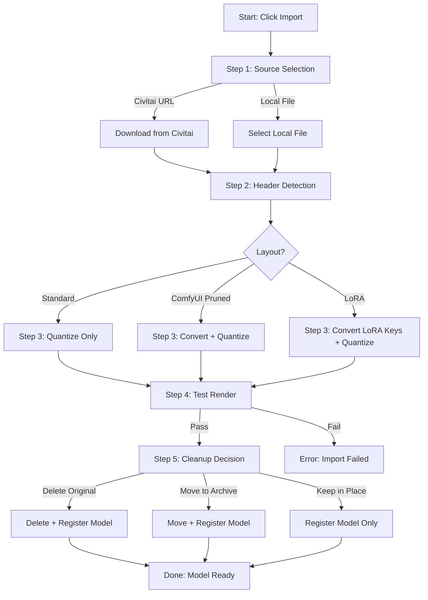
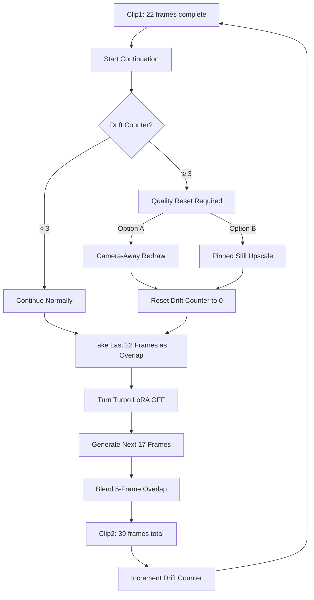
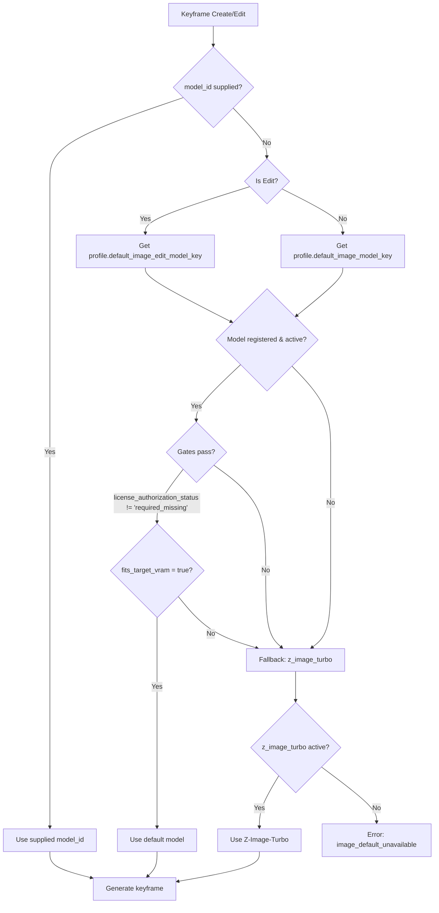

# Movie Maker UI/UX Specification

**UI/UX Design & Implementation Guide**

**Version:** 1.0  
**Date:** 26 November 2026  
**Target:** Coding agents building Movie Maker UI on AIMoveMaker v1 React/Vite frontend  
**Foundation:** Addendum v1.2, actual frontend code at `/workspace/frontend/src`

---

## Table of Contents

1. [Information Architecture](#information-architecture)
2. [Design System & Components](#design-system--components)
3. [Screens & Workflows](#screens--workflows)
4. [WebSocket Progress & Real-Time Features](#websocket-progress--real-time-features)
5. [Responsive Behavior & Accessibility](#responsive-behavior--accessibility)

---

## Information Architecture

### Navigation by Role

```
┌─────────────────────────────────────────────────────────────┐
│  App Navigation (All Roles)                                 │
├─────────────────────────────────────────────────────────────┤
│  Logo │ Projects │ Settings │ [Avatar▾]                     │
└─────────────────────────────────────────────────────────────┘

Admin-only additions:
  │ Admin │ Models │

Role-specific project views:
  Creative → Storyboard View
  Engineer → Timeline View
  Admin → Both + Members + Handoffs
  Viewer → Read-only
```

**Current Implementation:** `frontend/src/components/AppShell.tsx` with role-based sidebar links from `useAuthStore().user.global_role`

---

### Route Structure

```
/                           → ProjectsView (list all accessible projects)
/projects                   → Same as /
/projects/:id/storyboard    → StoryboardView (Creative phase, RBAC-gated)
/projects/:id/timeline      → TimelineView (Engineer phase, RBAC-gated)
/admin                      → AdminView (Admin-only: users, approvals, invites)
/settings                   → SettingsView (user profile, secrets, model folders)
/models                     → ModelsView (NEW: library + Import Model wizard)
/login                      → LoginView
/change-password            → ChangePasswordView
```

**Route guards:** `ProtectedRoute` checks JWT + `force_password_change` flag (redirects to `/change-password` if true)

---

## Design System & Components

### Color Palette (Phase 5 Blue-Green Theme)

```css
/* Primary */
--color-background: #081A24;        /* Deep blue-black */
--color-primary: #36A9E8;           /* Bright cyan-blue */
--color-accent: #2DD4BF;            /* Teal-green */

/* Neutrals */
--color-surface: #0D2535;           /* Slightly lighter surface */
--color-border: #1A3A4F;            /* Subtle borders */
--color-text: #E5F1F8;              /* Off-white text */
--color-text-muted: #8FA8B8;        /* Muted secondary text */

/* Status */
--color-success: #10B981;           /* Green */
--color-warning: #F59E0B;           /* Amber */
--color-error: #EF4444;             /* Red */
```

**Apply in:** `frontend/src/index.css` and Tailwind config

---

### Component Library

**Existing (Shadcn/ui):**
- `Button` (`components/ui/button.tsx`)
- `Input` (`components/ui/input.tsx`)

**To Add:**
- `Select`, `Dropdown`, `Modal`, `Tabs`, `Badge`, `Card`, `Toast`, `Progress`, `Slider`

**Custom Components:**
- `AppShell` (sidebar + header + presence indicator)
- `CanvasEditor` (inpaint/outpaint masks)
- `NotificationsDropdown` (bell icon + dropdown)
- `CommandPalette` (Cmd+K quick actions)

---

### Reusable Patterns

#### 1. **List View with Cards**

```tsx
// Pattern: Grid of cards with actions
<div className="grid grid-cols-1 md:grid-cols-2 lg:grid-cols-3 gap-4">
  {items.map(item => (
    <Card key={item.id}>
      <CardHeader>
        <CardTitle>{item.title}</CardTitle>
        <Badge>{item.status}</Badge>
      </CardHeader>
      <CardContent>
        <p className="text-muted">{item.description}</p>
      </CardContent>
      <CardActions>
        <Button onClick={() => onEdit(item.id)}>Edit</Button>
        <Button variant="ghost" onClick={() => onDelete(item.id)}>Delete</Button>
      </CardActions>
    </Card>
  ))}
</div>
```

**Used in:** ProjectsView, ModelsView

#### 2. **Empty State**

```tsx
<div className="flex flex-col items-center justify-center py-12 text-center">
  <EmptyIcon className="h-16 w-16 text-muted mb-4" />
  <h3 className="text-lg font-semibold">No items yet</h3>
  <p className="text-muted mt-2">Get started by creating your first item.</p>
  <Button className="mt-4" onClick={onCreate}>Create Now</Button>
</div>
```

#### 3. **Loading State**

```tsx
{isLoading ? (
  <div className="flex items-center justify-center py-12">
    <Spinner className="h-8 w-8 animate-spin" />
    <span className="ml-2 text-muted">Loading...</span>
  </div>
) : (
  <ContentComponent data={data} />
)}
```

#### 4. **Error State**

```tsx
{error && (
  <Alert variant="destructive">
    <AlertCircle className="h-4 w-4" />
    <AlertTitle>Error</AlertTitle>
    <AlertDescription>{error.message}</AlertDescription>
    <Button variant="outline" onClick={onRetry}>Retry</Button>
  </Alert>
)}
```

---

## Screens & Workflows

### 1. ProjectsView (All Roles)

**Purpose:** List all accessible projects, create new projects (Admin only)

**Layout:**
```
┌────────────────────────────────────────────────────────────┐
│  Projects                                     [+ New Project]│
├────────────────────────────────────────────────────────────┤
│  [Search...]                     [Filter: All ▾] [Sort ▾]  │
├────────────────────────────────────────────────────────────┤
│  ┌──────────────┐  ┌──────────────┐  ┌──────────────┐    │
│  │ Project A    │  │ Project B    │  │ Project C    │    │
│  │ [H3]         │  │ [LTX-2.5]    │  │ [H3]         │    │
│  │ Creative     │  │ Engineer     │  │ Completed    │    │
│  │ 3 members    │  │ 2 members    │  │ 5 members    │    │
│  │ [Open]       │  │ [Open]       │  │ [Archive]    │    │
│  └──────────────┘  └──────────────┘  └──────────────┘    │
└────────────────────────────────────────────────────────────┘
```

**Components:**
- Project cards with core model badge, state badge, member count
- Search filter (title/description)
- Sort: created_at desc, title asc
- Pagination controls

**States:**
- **Empty:** "No projects yet. Create your first project to get started."
- **Loading:** Spinner + "Loading projects..."
- **Error:** Alert + retry button

**New Project Modal (Admin only):**
```
┌────────────────────────────────────────┐
│  Create New Project                    │
├────────────────────────────────────────┤
│  Title:          [________________]    │
│  Description:    [________________]    │
│                  [________________]    │
│  Core Model:     ( ) MiniMax H3        │
│                  (•) LTX-2.5           │
│                  ( ) Wan + Bernini     │
│  Workflow:       [H3 Default ▾]        │
│  Resolution:     [1280x720 ▾]          │
│  FPS:            [24 ▾]                │
│                                        │
│           [Cancel]  [Create Project]   │
└────────────────────────────────────────┘
```

**Validation:**
- Title required (1-255 chars)
- Core model required (radio buttons)
- Workflow auto-selected based on core model

**API Calls:**
- `GET /api/projects?skip=0&limit=20` (on mount)
- `POST /api/projects` (create, Admin only)

**Acceptance Criteria (PROFILE-01, PROFILE-02):**
- Core model selection shown as radio buttons
- Core model badge displayed on project cards
- Admin sees "+ New Project" button
- Creative/Engineer/Viewer do NOT see "+ New Project"

---

### 2. ModelsView (Admin/Engineer Only, NEW)

**Purpose:** Browse model/LoRA library, scan folders, Import Model wizard

**Layout:**
```
┌────────────────────────────────────────────────────────────┐
│  Models & LoRAs                 [Scan Folders] [+ Import]  │
├────────────────────────────────────────────────────────────┤
│  [Search...]  [Filter: All ▾]  [Base: All ▾]  [Vis: All ▾]│
├────────────────────────────────────────────────────────────┤
│  ┌────────────────────────────────────────────────────┐   │
│  │ MiniMax H3 Base (BF16)             [FP8] [Global]  │   │
│  │ Path: /models/h3_base.safetensors                  │   │
│  │ Companions: Qwen3-VL, VAE, Audio VAE ✓             │   │
│  │ [View Details]                                      │   │
│  └────────────────────────────────────────────────────┘   │
│  ┌────────────────────────────────────────────────────┐   │
│  │ Turbo LoRA (Stage 1+2)             [FP8] [User]    │   │
│  │ Base: minimax_h3  │  Partition: fl2va              │   │
│  │ ⚠ Hits ~2x harder on 10Eros_Max                   │   │
│  │ [Use in Project]                                    │   │
│  └────────────────────────────────────────────────────┘   │
└────────────────────────────────────────────────────────────┘
```

**Components:**
- Model/LoRA cards with badges (quantization, visibility, partition)
- Search: name/path
- Filters: base model, visibility (global/user), quantization
- Scan button: triggers recursive folder scan
- Import button: opens Import Model wizard

**Scan Folders Flow:**
```
Click [Scan Folders] → Progress modal → "Scanned 123 files, registered 45, skipped 78" → Refresh list
```

**Import Model Wizard (Multi-Step Modal):**

**Step 1: Source Selection**
```
┌────────────────────────────────────────┐
│  Import Model                          │
├────────────────────────────────────────┤
│  Source:                               │
│  ( ) Civitai URL                       │
│      [https://civitai.com/models/...]  │
│  (•) Local File                        │
│      [Browse...]                       │
│      /path/to/model.safetensors        │
│                                        │
│           [Cancel]  [Next: Detect →]   │
└────────────────────────────────────────┘
```

**Step 2: Header Detection**
```
┌────────────────────────────────────────┐
│  Import Model - Layout Detected        │
├────────────────────────────────────────┤
│  File: 10Eros_Max_v1.0_hybrid.saf...  │
│  Layout: ComfyUI Pruned (534 tensors)  │
│  Detected: adaln_basis, fused QKV      │
│                                        │
│  Base Model: [MiniMax H3 ▾]            │
│  Visibility: (•) Global  ( ) User      │
│                                        │
│  Convert to:                           │
│  (•) FP8 (TorchAO)                     │
│  ( ) NVFP4 (ModelOpt, sm_120 only)     │
│                                        │
│         [← Back]  [Convert & Test →]   │
└────────────────────────────────────────┘
```

**Step 3: Convert + Quantize + Test Render (Progress)**
```
┌────────────────────────────────────────┐
│  Import Model - Converting              │
├────────────────────────────────────────┤
│  [████████████░░░░░░░░] 60%            │
│  Current: Quantizing to FP8...         │
│  ETA: 2m 15s                           │
│                                        │
│  Logs:                                 │
│  ✓ Loaded 534 tensors                  │
│  ✓ Split QKV [21504,5376] → Q/K/V     │
│  ✓ Expanded adaln_basis [8,2688]       │
│  ⏳ Quantizing with TorchAO...        │
│                                        │
│  [WebSocket live updates]              │
└────────────────────────────────────────┘
```

**Step 4: Safety Gate (Test Render)**
```
┌────────────────────────────────────────┐
│  Import Model - Safety Test            │
├────────────────────────────────────────┤
│  Running test render (22 frames)...    │
│  [████████████████████] 100%           │
│                                        │
│  ✓ Model loaded successfully           │
│  ✓ Sample render complete (3.2s)       │
│  ✓ Output: 22 frames @ 480x848         │
│  Peak VRAM: 28.4 GB / 32 GB            │
│                                        │
│  [Preview player: 22-frame clip]       │
│                                        │
│           [← Back]  [Finalize →]       │
└────────────────────────────────────────┘
```

**Step 5: Cleanup Decision**
```
┌────────────────────────────────────────┐
│  Import Model - Finalize               │
├────────────────────────────────────────┤
│  Converted model ready:                │
│  /models/imported/10Eros_Max_v1.0.saf  │
│                                        │
│  Original file:                        │
│  /models/10Eros_Max_v1.0_hybrid.saf    │
│  Size: 37.2 GB                         │
│                                        │
│  Action:                               │
│  ( ) Delete original (saves 37.2 GB)   │
│  (•) Move to archive folder            │
│      [/models/archive/]                │
│  ( ) Keep in place                     │
│                                        │
│  ⚠ Check: 0 active projects reference │
│    this file                           │
│                                        │
│           [← Back]  [Finish]           │
└────────────────────────────────────────┘
```

**WebSocket Progress:** `useWebSocket('/api/ws/imports/{job_id}')` streams conversion + quantization + test render progress

**API Calls:**
- `POST /api/integrations/civitai/fetch` (Civitai download)
- `POST /api/models/import` (start import job)
- `POST /api/models/import/{id}/finalize` (cleanup decision)
- `POST /api/models/scan` (recursive folder scan)

**Acceptance Criteria (IMPORT-01 to IMPORT-08, LIB-01 to LIB-08):**
- Admin/Engineer see Models nav item
- Creative/Viewer do NOT see Models nav
- Import wizard shows 5 steps with progress
- WebSocket streams live conversion progress
- Safety gate shows preview player + VRAM usage
- Cleanup only enabled when RBAC + reference checks pass
- Scan folders updates list in real-time

---

### 3. StoryboardView (Creative Phase)

**Purpose:** Creative designs shots, 6-field H3 prompts, RefMods, 3-seed Stage-1 previews, Stage-2 upscale reroll

**Layout (Enhanced for Movie Maker):**
```
┌────────────────────────────────────────────────────────────────┐
│  Project: Epic Film [H3] [Creative Active]     [Hand Off →]   │
├────────────────────────────────────────────────────────────────┤
│  [+ Add Shot]  [Bulk Actions ▾]  [Preview All]                │
├────────────────────────────────────────────────────────────────┤
│  Shot 1: Forest Opening                                        │
│  ┌──────────────────────────────────────────────────────────┐ │
│  │ H3 Prompt IDE (6 Sections)                                │ │
│  │ ┌─────────────────────────────────────────────────────┐  │ │
│  │ │ Subject Definitions:                                 │  │ │
│  │ │ [<Subject 1>: A young knight in silver armor...]    │  │ │
│  │ ├─────────────────────────────────────────────────────┤  │ │
│  │ │ Summary: Knight enters enchanted forest...          │  │ │
│  │ ├─────────────────────────────────────────────────────┤  │ │
│  │ │ Retention Analysis: Focus on armor details...       │  │ │
│  │ ├─────────────────────────────────────────────────────┤  │ │
│  │ │ Detailed Description:                               │  │ │
│  │ │ [Shot 1] Wide establishing <d>[English: forest]     │  │ │
│  │ │ [Shot 2] Medium close-up <d>[English: knight]       │  │ │
│  │ ├─────────────────────────────────────────────────────┤  │ │
│  │ │ Overall Soundscape: Birds chirping, wind...         │  │ │
│  │ ├─────────────────────────────────────────────────────┤  │ │
│  │ │ Non-Diegetic Music: Orchestral swell...             │  │ │
│  │ └─────────────────────────────────────────────────────┘  │ │
│  │                                                          │ │
│  │ RefMods (Multimedia References):                        │ │
│  │ <Picture 1>: [Upload Image] [Weight: 0.8 ═══●═]        │ │
│  │ <Audio 1>:   [Upload Audio] [Weight: 0.6 ═●═══]        │ │
│  │                                                          │ │
│  │ LoRA Stack (Stage 1+2):                                 │ │
│  │ ✓ Turbo Dareties v2 @ 0.75                             │ │
│  │ ✓ Realism LoRA @ 0.5                                    │ │
│  │ ⚠ Note: These LoRAs hit ~2x harder on 10Eros_Max       │ │
│  │                                                          │ │
│  │ [Expand with LLM]  [Save Draft]  [Generate 3 Previews] │ │
│  └──────────────────────────────────────────────────────────┘ │
│                                                                │
│  Stage-1 Previews (0.2-0.4 MP, 22 frames):                    │
│  ┌──────────┐  ┌──────────┐  ┌──────────┐                    │
│  │ Seed a   │  │ Seed a+  │  │ Seed a+  │                    │
│  │ [Preview]│  │ 1000     │  │ 2000     │                    │
│  │ (•) Pick │  │ [Preview]│  │ [Preview]│                    │
│  └──────────┘  └──────────┘  └──────────┘                    │
│                 [Select Winner & Upscale to Stage-2 →]        │
└────────────────────────────────────────────────────────────────┘
```

**Key Features:**

1. **H3 Prompt IDE (6 Sections):**
   - Subject Definitions
   - Summary
   - Retention Analysis
   - Detailed Description (with `[Shot N]` / `<d>[English: ...]` tags)
   - Overall Soundscape
   - Non-Diegetic Music
   - Dual-buffer: draft vs committed
   - Expand with LLM: `POST /api/prompts/expand-scene-plan`

2. **RefMods:**
   - Upload `<Picture 1>`, `<Picture 2>` (first/last frame pins)
   - Upload `<Audio 1>` (vocal ref for voice cloner)
   - Weight sliders: 0.0 - 1.0

3. **LoRA Stack:**
   - Filtered to project's `core_video_model` + partition (`fl2va` / `ref2va`)
   - Shows compatibility warnings from `lora_compatibility_notes`
   - Slots: Stage 1+2, Upscale-only, Vocal

4. **3-Seed Stage-1 Previews:**
   - Generate 3 previews at seeds `a`, `a+1000`, `a+2000`
   - Low resolution: 0.2–0.4 MP, 22 frames (`17n+5`)
   - Preview player (inline video)
   - Radio buttons: pick winner
   - "Upscale to Stage-2" button (opens Stage-2 modal)

**Stage-2 Modal:**
```
┌────────────────────────────────────────┐
│  Stage-2 Latent Upscale                │
├────────────────────────────────────────┤
│  Selected Preview: Seed a+1000         │
│  [Preview player]                      │
│                                        │
│  Target Resolution: [1280x720 ▾]       │
│  Upscale LoRA: [None ▾]                │
│  Reroll Seed: [Auto] or [Custom...]   │
│  Steps: [4 ▾] (2-6)                    │
│                                        │
│  [Generate Upscaled Version]           │
│                                        │
│  After upscale:                        │
│  ☑ Export first frame PNG              │
│  ☑ Export last frame PNG               │
│                                        │
│           [Cancel]  [Generate]         │
└────────────────────────────────────────┘
```

**Role Gates:**
- Creative: full edit
- Engineer: read-only view
- Admin: full edit + members management
- Viewer: read-only

**API Calls:**
- `GET /api/storyboard/{id}/keyframes`
- `POST /api/keyframes` (create shot)
- `PATCH /api/keyframes/{id}` (update prompt, RefMods)
- `POST /api/video-clips` (generate 3-seed previews)
- `POST /api/video-clips/{id}/promote-preview` (pick winner)
- `POST /api/video-clips/{id}/reroll-upscale` (Stage-2)

**Acceptance Criteria (PROMPT-01 to PROMPT-09, PREVIEW-01 to PREVIEW-05, LORA-01 to LORA-09):**
- 6-field H3 Prompt IDE with validation
- RefMods upload + weight sliders
- LoRA stack filtered by project core model
- Compatibility warnings displayed
- 3-seed preview generation with WebSocket progress
- Pick winner radio buttons
- Stage-2 modal with reroll seed

---

### 4. TimelineView (Engineer Phase)

**Purpose:** Engineer assembles timeline, 17n+5 continuation, drift counter, seam color grading, voice cloner, render queue

**Layout (Enhanced for Movie Maker):**
```
┌────────────────────────────────────────────────────────────────┐
│  Project: Epic Film [H3] [Engineer Active]  [Return to Creative]│
├────────────────────────────────────────────────────────────────┤
│  Timeline (24 fps, 17n+5 frame snapping):                       │
│  ┌──────────────────────────────────────────────────────────┐  │
│  │  0s     5s     10s    15s    20s    25s    30s          │  │
│  │  ├──────┼──────┼──────┼──────┼──────┼──────┼──────      │  │
│  │  │ Clip1│      │ Clip2│ ⚠3  │      │ Clip3│            │  │
│  │  │  22f │      │  39f │drift│      │  56f │            │  │
│  │  ├──────┴──────┴──────┴──────┴──────┴──────┘            │  │
│  │  │ Audio Track 1 (Joint H3 Audio)                       │  │
│  │  ├─────────────────────────────────────────────────────┤  │
│  │  │ Caption Track (ASR Subtitles)                        │  │
│  │  └─────────────────────────────────────────────────────┘  │
│  │  Playhead: [▶] [Scrub bar]                              │  │
│  └──────────────────────────────────────────────────────────┘  │
│                                                                │
│  Selected Clip: Clip2 (22 → 39 frames)                        │
│  ┌──────────────────────────────────────────────────────────┐ │
│  │ Mode: Continuation (17n+5 overlap)                       │ │
│  │ Overlap: 22 frames from Clip1 end                        │ │
│  │ Drift Counter: 2 / ~3 (⚠ Quality reset recommended)     │ │
│  │                                                           │ │
│  │ Quality Reset Options:                                   │ │
│  │ ( ) Continue as-is                                       │ │
│  │ (•) Camera-away redraw (from <Subject> sheet)           │ │
│  │ ( ) Pinned last-frame still upscale (<Picture 2>)       │ │
│  │                                                           │ │
│  │ Continuation Settings:                                   │ │
│  │ ☐ Turbo LoRA OFF (10-14 steps)                          │ │
│  │ Scheduler: [er_sde ▾] / [beta ▾] (dual)                 │ │
│  │                                                           │ │
│  │ [Continue 17 More Frames]  [Reset & Continue]           │ │
│  └──────────────────────────────────────────────────────────┘ │
│                                                                │
│  Seam Finishing (Adjacent Clips):                             │
│  ┌──────────────────────────────────────────────────────────┐ │
│  │ Clip1 End Frame    vs    Clip2 Start Frame               │ │
│  │ [Frame preview]           [Frame preview]                 │ │
│  │                                                           │ │
│  │ Color Match:                                             │ │
│  │ Brightness: [-10 ════●══ +10]                            │ │
│  │ Contrast:   [ -5 ═══●═══ +5 ]                            │ │
│  │ Warmth:     [ -5 ══●════ +5 ]                            │ │
│  │                                                           │ │
│  │ Transition:                                              │ │
│  │ ☑ Gaussian blur (5-frame blend)                          │ │
│  │ ☑ Micro-zoom + glow (CineFocus)                          │ │
│  │                                                           │ │
│  │ [Apply Seam Grade]                                       │ │
│  └──────────────────────────────────────────────────────────┘ │
│                                                                │
│  Voice Cloner (Audio Track):                                  │
│  ┌──────────────────────────────────────────────────────────┐ │
│  │ Dialogue / Voice Cloner                                   │ │
│  │ Vocal Ref: [<Audio 1>] or [Upload 15-45s sample]         │ │
│  │                                                           │ │
│  │ Script: "Hello, *brave* knight. The forest awaits."     │ │
│  │         (*word* = emphasis)                              │ │
│  │                                                           │ │
│  │ Scene Tone: [Mysterious, slightly ominous]               │ │
│  │ Length: [Auto] or [5.2s]                                 │ │
│  │                                                           │ │
│  │ Generate 3 Takes:                                        │ │
│  │ [Take #1 ▶] [Take #2 ▶] [Take #3 ▶]                     │ │
│  │                                                           │ │
│  │ Silence Pad: [Add 0.5s before/after]                     │ │
│  │                                                           │ │
│  │ [Generate Takes]  [Force into Video Latent]             │ │
│  └──────────────────────────────────────────────────────────┘ │
│                                                                │
│  Render Queue:                                                 │
│  ┌──────────────────────────────────────────────────────────┐ │
│  │ ┌──────────────────────────────────────────────────────┐ │ │
│  │ │ Job #1234: Clip2 Continuation      [████░░░░] 60%    │ │ │
│  │ │ Queue: gpu_h3  │  ETA: 1m 20s      [Cancel]          │ │ │
│  │ ├──────────────────────────────────────────────────────┤ │ │
│  │ │ Job #1235: Voice Clone Take #1     [Pending]         │ │ │
│  │ │ Queue: gpu_audio                                      │ │ │
│  │ └──────────────────────────────────────────────────────┘ │ │
│  └──────────────────────────────────────────────────────────┘ │
│                                                                │
│  GPU Status: RTX 5090 | VRAM: 24.3 / 32 GB | Temp: 68°C      │
└────────────────────────────────────────────────────────────────┘
```

**Key Features:**

1. **17n+5 Frame Snapping:**
   - Clips snap to 22, 39, 56, 73 frames (17n+5)
   - Overlap conditioning: last 5/22/39/56 frames of previous clip
   - Visual indicator on timeline

2. **Drift Counter & Quality Resets:**
   - Counter: 0 / ~3 (turns orange at 2, red at 3)
   - Reset options: camera-away redraw, pinned still upscale
   - Stale downstream flags (downstream clips marked for re-render)

3. **Seam Color Grading:**
   - Side-by-side frame preview (Clip A end vs Clip B start)
   - Sliders: brightness, contrast, warmth, exposure
   - Transition effects: Gaussian blur, micro-zoom + glow
   - Apply per-clip LUT to FFmpeg render

4. **Voice Cloner / Dialogue Pre-Gen:**
   - Upload vocal ref or use `<Audio 1>` from storyboard
   - Script with `*emphasis*` markdown
   - Generate 3 audio takes
   - Silence padding before/after
   - Force into video latent: `VAEEncodeAudio` + `SetLatentNoiseMask`

5. **Render Queue with WebSocket Progress:**
   - Live job list with progress bars
   - Queue assignment (gpu_h3, gpu_ltx, gpu_audio, import_cpu)
   - ETA, cancel button
   - GPU status panel (VRAM, temp)

**Role Gates:**
- Engineer: full edit
- Creative: read-only view
- Admin: full edit + members management
- Viewer: read-only

**API Calls:**
- `GET /api/timeline/{id}/tracks`
- `POST /api/video-clips/{id}/continue` (17n+5 continuation)
- `POST /api/audio-clips/{id}/dialogue-clone` (voice cloner)
- `POST /api/jobs` (submit render job)
- WebSocket: `/api/ws/jobs/{job_id}`

**Acceptance Criteria (CONT-01 to CONT-08, GEN-05, EDIT-05, MEDIA-01 to MEDIA-03):**
- 17n+5 frame snapping enforced
- Drift counter visible + quality reset options
- Seam color grading sliders functional
- Voice cloner generates 3 takes with WebSocket progress
- Render queue shows live progress
- GPU status panel updates in real-time

---

### 5. AdminView (Admin Only)

**Purpose:** Manage users, approvals, invites, secrets, workers

**Layout:**
```
┌────────────────────────────────────────────────────────────┐
│  Admin Panel                                               │
├────────────────────────────────────────────────────────────┤
│  [Users] [Approvals] [Invites] [Secrets] [Workers]        │
├────────────────────────────────────────────────────────────┤
│  Users:                                                    │
│  [Search...]  [+ Invite User]                             │
│  ┌──────────────────────────────────────────────────────┐ │
│  │ Email            Role      Status      Actions        │ │
│  ├──────────────────────────────────────────────────────┤ │
│  │ alice@ex.com     Admin     Active      [Edit] [...]   │ │
│  │ bob@ex.com       Creative  Pending     [Approve] [...] │ │
│  │ carol@ex.com     Engineer  Active      [Edit] [...]   │ │
│  └──────────────────────────────────────────────────────┘ │
└────────────────────────────────────────────────────────────┘
```

**Tabs:**

1. **Users:** List, edit roles, deactivate
2. **Approvals:** Pending user approvals (approve/reject)
3. **Invites:** Send invite emails, view pending invites
4. **Secrets:** Admin `.env` variables (masked, is_set only)
5. **Workers:** Self-hosted worker status (Phase 5, Vast.ai)

**Existing Implementation:** `frontend/src/views/AdminView.tsx` (users + invites)

**To Add:**
- **Secrets Tab:** `GET /api/settings/admin-env`, `POST /api/settings/admin-env`
  - Show: `VASTAI_API_KEY`, `HF_TOKEN`, `CIVITAI_API_KEY`, `SMTP_*`
  - Form: key/value input, never show values
- **Workers Tab:** List self-hosted workers, Vast.ai offers, connection status

---

### 6. SettingsView (All Roles)

**Purpose:** User profile, password change, model folder roots (Admin), user secret overrides

**Layout:**
```
┌────────────────────────────────────────────────────────────┐
│  Settings                                                  │
├────────────────────────────────────────────────────────────┤
│  [Profile] [Security] [Model Folders] [Secrets]           │
├────────────────────────────────────────────────────────────┤
│  Profile:                                                  │
│  Full Name:  [Alice Johnson___________]                   │
│  Email:      alice@example.com (read-only)                │
│  [Save Changes]                                            │
│                                                            │
│  Security:                                                 │
│  [Change Password]                                         │
│                                                            │
│  Model Folders (Admin only):                              │
│  Scan Roots:                                               │
│  - /mnt/models                             [Remove]        │
│  - /data/loras                             [Remove]        │
│  [+ Add Folder]                                            │
│  [Scan Now]                                                │
│                                                            │
│  User Secrets (Optional Overrides):                        │
│  HF_TOKEN: [Override with personal token...]              │
│  CIVITAI_API_KEY: [Override...]                            │
│  [Save Overrides]                                          │
└────────────────────────────────────────────────────────────┘
```

**Existing Implementation:** `frontend/src/views/SettingsView.tsx` (profile + password)

**To Add:**
- **Model Folders Tab (Admin only):** Manage `MODEL_ROOTS` from `config.py`
- **Secrets Tab (All roles):** Per-user credential overrides (encrypted per user)

---

## WebSocket Progress & Real-Time Features

### Job Progress (`/api/ws/jobs/{job_id}`)

**Channel:** `job:{job_id}`  
**Message Format:**
```json
{
  "job_id": "abc123",
  "progress_pct": 60,
  "current_step": 3,
  "total_steps": 5,
  "eta_seconds": 80,
  "status": "running",
  "timestamp": "2026-11-26T21:30:00Z"
}
```

**Frontend Hook:**
```typescript
const { data, isConnected } = useWebSocket(`/api/ws/jobs/${jobId}`)

// data = { progress_pct, current_step, total_steps, eta_seconds, status }
```

**Usage:**
- Render queue in TimelineView
- Import Model progress in ModelsView
- Progress bars with ETA

---

### Import Progress (`/api/ws/imports/{job_id}`)

**Channel:** `import:{job_id}`  
**Message Format:**
```json
{
  "job_id": "import_xyz",
  "progress_pct": 45,
  "current_step": "quantizing",
  "logs": ["✓ Split QKV", "⏳ Quantizing with TorchAO..."],
  "status": "running",
  "timestamp": "2026-11-26T21:30:00Z"
}
```

**Usage:**
- Import Model wizard Step 3
- Live logs streaming

---

### Project Presence (`/api/ws/projects/{project_id}`)

**Channel:** `project:{project_id}`  
**Message Format:**
```json
{
  "type": "presence_update",
  "users": [
    {"id": "user1", "full_name": "Alice", "last_active": "2026-11-26T21:30:00Z"},
    {"id": "user2", "full_name": "Bob", "last_active": "2026-11-26T21:29:45Z"}
  ],
  "timestamp": "2026-11-26T21:30:00Z"
}
```

**Usage:**
- AppShell presence indicator (avatars)
- Collaborative editing awareness

---

## Responsive Behavior & Accessibility

### Responsive Breakpoints

```css
/* Tailwind breakpoints */
sm: 640px   /* Small tablets */
md: 768px   /* Tablets */
lg: 1024px  /* Laptops */
xl: 1280px  /* Desktops */
2xl: 1536px /* Large desktops */
```

**Layout Adjustments:**
- **Mobile (< 640px):** Single-column, stacked components
- **Tablet (640-1024px):** 2-column grid for cards, collapsed sidebar
- **Desktop (> 1024px):** Full 3-column grid, expanded sidebar

**Example:**
```tsx
<div className="grid grid-cols-1 md:grid-cols-2 lg:grid-cols-3 gap-4">
  {/* Cards */}
</div>
```

---

### Accessibility

1. **Keyboard Navigation:**
   - All interactive elements focusable (Tab order)
   - Escape closes modals
   - Cmd/Ctrl+K opens command palette

2. **ARIA Labels:**
   - `aria-label` on icon buttons
   - `aria-live` regions for progress updates
   - `role="status"` for loading states

3. **Color Contrast:**
   - WCAG AA compliant (4.5:1 for text, 3:1 for UI elements)
   - Use `--color-text` / `--color-text-muted` from palette

4. **Screen Readers:**
   - Meaningful alt text on images
   - Hidden labels for icon-only buttons
   - Skip navigation links

---

## Wireframe Examples (ASCII)

### ProjectsView (Empty State)
```
┌────────────────────────────────────────────┐
│  Projects                   [+ New Project]│
├────────────────────────────────────────────┤
│                                            │
│           [Empty Folder Icon]              │
│                                            │
│      No projects yet                       │
│                                            │
│  Create your first project to get started │
│                                            │
│           [Create Project]                 │
│                                            │
└────────────────────────────────────────────┘
```

### StoryboardView (3-Seed Previews)
```
┌──────────────────────────────────────────────────────┐
│  Shot 1: Forest Opening                              │
├──────────────────────────────────────────────────────┤
│  Stage-1 Previews (22 frames, 0.3 MP):               │
│  ┌────────────┐  ┌────────────┐  ┌────────────┐    │
│  │ Seed a     │  │ Seed a+1000│  │ Seed a+2000│    │
│  │ [▶ Play]   │  │ [▶ Play]   │  │ [▶ Play]   │    │
│  │            │  │            │  │            │    │
│  │ [Preview]  │  │ [Preview]  │  │ [Preview]  │    │
│  │            │  │            │  │            │    │
│  │ (•) Pick   │  │ ( ) Pick   │  │ ( ) Pick   │    │
│  └────────────┘  └────────────┘  └────────────┘    │
│                                                      │
│  [Upscale Selected to Stage-2 →]                    │
└──────────────────────────────────────────────────────┘
```

### TimelineView (Seam Grading)
```
┌──────────────────────────────────────────────────────┐
│  Seam Finishing: Clip1 → Clip2                       │
├──────────────────────────────────────────────────────┤
│  ┌──────────────┐        ┌──────────────┐           │
│  │ Clip1 End    │   →    │ Clip2 Start  │           │
│  │ Frame 22     │        │ Frame 1      │           │
│  │ [Preview]    │        │ [Preview]    │           │
│  └──────────────┘        └──────────────┘           │
│                                                      │
│  Color Match:                                        │
│  Brightness: [-10 ════●══ +10]                       │
│  Contrast:   [ -5 ═══●═══ +5 ]                       │
│  Warmth:     [ -5 ══●════ +5 ]                       │
│                                                      │
│  Transition:                                         │
│  ☑ Gaussian blur (5-frame blend)                     │
│  ☑ Micro-zoom + glow                                 │
│                                                      │
│  [Apply Grade] [Reset]                               │
└──────────────────────────────────────────────────────┘
```

---

## Mermaid Flow: Import Model Wizard



---

## Mermaid Flow: 17n+5 Continuation with Quality Reset



---

**End of UI_UX_SPEC.md**

For complete technical implementation, see `/workspace/PRD/BUILD_GUIDE.md`.

For complete integration plan, see `/workspace/PRD/MovieMaker_Integration_Map.md`.

---

## v1.3 Addendum: Keyframe Image Model Defaults UI

**Added:** November 26, 2026

### StoryboardView Updates: Image Model Picker with Defaults & Gates

**Purpose:** Show keyframe image model picker with live default, alternates, and license/VRAM gate badges.

**Enhanced Keyframe Card:**
```
┌────────────────────────────────────────────────────────────┐
│  Shot 1: Forest Opening                                    │
├────────────────────────────────────────────────────────────┤
│  Image Model: [Krea 2 Turbo ▾] ⚡ DEFAULT                 │
│  ┌──────────────────────────────────────────────────────┐ │
│  │ ✓ Krea 2 Turbo          [⚡ T2I Default] [⚠ License]  │ │
│  │ ✓ Z-Image-Turbo         [Apache-2.0]                  │ │
│  │ ✓ FLUX 3 Image Klein    [✏️ Edit Default] [⚠ License] │ │
│  │ ⊗ MiniMax-H3-Image      [🔒 License] [⚠ VRAM]        │ │
│  │ ✓ FLUX.1 [dev]          [LoRA Rich]                   │ │
│  │ ✓ SDXL 1.0              [v1 Compatible]               │ │
│  └──────────────────────────────────────────────────────┘ │
│                                                            │
│  H3 Prompt IDE (6 Sections) ...                           │
└────────────────────────────────────────────────────────────┘
```

**Badge Key:**
- **⚡ T2I Default:** Live T2I default for this profile
- **✏️ Edit Default:** Live edit/consistency default
- **⚠ License:** Requires admin license acknowledgement
- **⚠ VRAM:** Does not fit 32 GB (IMG-GATE-02)
- **🔒 License:** Required license missing (IMG-GATE-01)
- **✓:** Model active & gates passed
- **⊗:** Model blocked (gate failed or inactive)

**Default Resolution (IMG-03, IMG-04, IMG-05):**
1. **For LTX/Wan projects:**
   - T2I default: [Krea 2 Turbo](https://huggingface.co/krea/Krea-2-Turbo) → falls back to [Z-Image-Turbo](https://huggingface.co/Tongyi-MAI/Z-Image-Turbo) if Krea 2 not enabled
   - Edit default: [FLUX 3 Image Klein](https://huggingface.co/black-forest-labs/flux-3-image-klein)

2. **For H3 projects:**
   - If IMG-GATE-01 & IMG-GATE-02 both pass: [MiniMax-H3-Image](https://huggingface.co/MiniMaxAI/MiniMax-H3-Image) for T2I & edit
   - Otherwise: same as LTX/Wan ([Krea 2 Turbo](https://huggingface.co/krea/Krea-2-Turbo) / [FLUX 3 Klein](https://huggingface.co/black-forest-labs/flux-3-image-klein))

3. **UI must show which default is live:**
   ```
   Current defaults for this project:
   T2I: Krea 2 Turbo ⚡
   Edit: FLUX 3 Image Klein ✏️
   
   (H3-Image gates not met; using global defaults)
   ```

---

### License Acknowledgement Flow

**Before enabling gated model ([Krea 2](https://huggingface.co/krea/Krea-2-Turbo), [FLUX 3 Klein](https://huggingface.co/black-forest-labs/flux-3-image-klein), [MiniMax-H3-Image](https://huggingface.co/MiniMaxAI/MiniMax-H3-Image)):**

```
┌────────────────────────────────────────┐
│  License Acknowledgement Required      │
├────────────────────────────────────────┤
│  Krea 2 Turbo / Krea 2 Raw             │
│                                        │
│  License: Krea 2 Community License     │
│                                        │
│  Terms:                                │
│  • Commercial use only if TTM revenue  │
│    < USD $1,000,000                    │
│  • Deployers MUST implement content    │
│    filters                             │
│  • Krea 2 Raw is HF-gated (token req.) │
│                                        │
│  ☐ I acknowledge the license terms    │
│  ☐ I confirm content filter hook      │
│     is configured                      │
│                                        │
│  HF Token: [••••••••••••] (gated)      │
│                                        │
│           [Cancel]  [Acknowledge]      │
└────────────────────────────────────────┘
```

**MiniMax-H3-Image (US excluded territory):**
```
┌────────────────────────────────────────┐
│  License Authorization Required        │
├────────────────────────────────────────┤
│  MiniMax-H3-Image                      │
│                                        │
│  ⚠ Excluded Territories:              │
│  United States, EU, UK, South Korea    │
│                                        │
│  ⚠ Revenue Threshold:                 │
│  Written authorization required if     │
│  TTM revenue ≥ USD $1,000,000          │
│                                        │
│  To enable MiniMax-H3-Image:           │
│  1. Obtain written authorization via   │
│     https://platform.minimax.io/       │
│        console/license                 │
│  2. Upload authorization document      │
│     [Upload PDF/Email...]              │
│  3. Admin will mark as 'recorded'      │
│                                        │
│  Current Status: 🔒 Authorization      │
│                   Missing              │
│                                        │
│           [Cancel]  [Upload Auth]      │
└────────────────────────────────────────┘
```

---

### Edit-from-Previous Keyframe Flow

**Purpose:** Create next keyframe from one or more previous keyframes using edit/consistency model (IMG-07).

**Workflow:**
```
┌────────────────────────────────────────────────────────────┐
│  Edit from Previous Keyframe                               │
├────────────────────────────────────────────────────────────┤
│  Source Keyframes: (select 1-10)                           │
│  ┌────────┐  ┌────────┐  ┌────────┐                       │
│  │ Shot 1 │  │ Shot 2 │  │ Shot 3 │                       │
│  │ [✓]    │  │ [✓]    │  │ [ ]    │                       │
│  └────────┘  └────────┘  └────────┘                       │
│                                                            │
│  Edit Model: [FLUX 3 Image Klein ▾] ✏️ EDIT DEFAULT       │
│  (Supports up to 10 reference images)                     │
│                                                            │
│  Prompt:                                                   │
│  [Same character, now in a dimly lit cave...]             │
│                                                            │
│  Edit Instructions:                                        │
│  [Maintain character consistency from Shot 1 and 2.       │
│   Add cave environment. Darker lighting.]                 │
│                                                            │
│  Strength: [0.8 ═══●═══════] (0.0 = keep original)       │
│                                                            │
│  LoRA Stack: (filtered to FLUX 3 Klein-base)              │
│  ✓ Character Consistency LoRA @ 0.9                       │
│                                                            │
│           [Cancel]  [Generate Edited Keyframe]            │
└────────────────────────────────────────────────────────────┘
```

**Key Features:**
1. **Multi-reference:** Select 1-10 source keyframes as references
2. **Edit model default:** Auto-selects `default_image_edit_model_key` from profile
3. **Model override:** Creative can pick alternate (MiniMax-H3-Image supports 16 refs)
4. **LoRA filtering:** Only show LoRAs compatible with selected edit model
5. **Strength slider:** Edit intensity (edit models like FLUX 3 Klein support variable strength)

**API Call:**
- `POST /api/keyframes/edit-from-previous`
  ```json
  {
    "source_keyframe_ids": ["keyframe_id_1", "keyframe_id_2"],
    "prompt": "Same character, now in a dimly lit cave...",
    "edit_instructions": "Maintain character consistency...",
    "strength": 0.8,
    "model_id": null,  // Uses default_image_edit_model_key
    "lora_ids": ["lora_id_1"]
  }
  ```

**WebSocket Progress:** `useWebSocket('/api/ws/jobs/${jobId}')` streams generation progress

---

### Model Library View: Image Models Tab

**Purpose:** Browse registered image models, see gates, enable/disable.

**Layout:**
```
┌────────────────────────────────────────────────────────────┐
│  Models & LoRAs              [Scan] [+ Import] [🎨 Images] │
├────────────────────────────────────────────────────────────┤
│  [Video Models] [Image Models] [LoRAs]                     │
├────────────────────────────────────────────────────────────┤
│  Image Models:                                             │
│  ┌──────────────────────────────────────────────────────┐ │
│  │ Krea 2 Turbo                           ⚡ T2I Default │ │
│  │ License: Krea 2 Community [⚠ Requires Ack]           │ │
│  │ VRAM: TBD (Phase 0)  │  Status: Inactive             │ │
│  │ [Download] [Acknowledge License]                      │ │
│  └──────────────────────────────────────────────────────┘ │
│  ┌──────────────────────────────────────────────────────┐ │
│  │ Z-Image-Turbo                          🔄 Fallback   │ │
│  │ License: Apache-2.0 ✓  │  VRAM: 16 GB ✓              │ │
│  │ Status: Active                                        │ │
│  │ [View Details] [Disable]                              │ │
│  └──────────────────────────────────────────────────────┘ │
│  ┌──────────────────────────────────────────────────────┐ │
│  │ FLUX 3 Image Klein                    ✏️ Edit Default │ │
│  │ License: FLUX Kommunity [⚠ Requires Ack]             │ │
│  │ VRAM: 32 GB (without upsampler) ⚠                    │ │
│  │ Status: Inactive                                      │ │
│  │ Note: 9B upsampler offloaded on 32 GB GPU            │ │
│  │ [Download] [Acknowledge License]                      │ │
│  └──────────────────────────────────────────────────────┘ │
│  ┌──────────────────────────────────────────────────────┐ │
│  │ MiniMax-H3-Image                      🔒 Gated       │ │
│  │ License: MiniMax-H3-Image Community [🔒 US Excluded] │ │
│  │ VRAM: TBD (quantization required) ⚠                  │ │
│  │ Status: License Authorization Missing                 │ │
│  │ [Request Authorization] [Upload Auth Doc]            │ │
│  └──────────────────────────────────────────────────────┘ │
└────────────────────────────────────────────────────────────┘
```

**Gate Status Indicators:**
- **✓:** Gate passed (green)
- **⚠:** Gate not met (amber)
- **🔒:** License blocked (red)
- **TBD:** Pending Phase 0 measurement

---

### ASCII Wireframes

**Keyframe Model Picker Dropdown:**
```
┌───────────────────────────────────────┐
│ Select Image Model                    │
├───────────────────────────────────────┤
│ ✓ Krea 2 Turbo      ⚡ T2I DEFAULT   │
│ ✓ Z-Image-Turbo     🔄 FALLBACK      │
│ ✓ FLUX 3 Klein      ✏️ EDIT DEFAULT  │
│ ⊗ MiniMax-H3-Image  🔒 LICENSE ⚠ VRAM│
│ ✓ FLUX.1 [dev]      📚 LORA RICH     │
│ ✓ SDXL 1.0          🏛️ V1 COMPAT     │
├───────────────────────────────────────┤
│ ⊗ = Blocked (license or VRAM gate)   │
└───────────────────────────────────────┘
```

**Edit-from-Previous Multi-Reference:**
```
┌─────────────────────────────────────────┐
│ Select Source Keyframes (1-10):         │
├─────────────────────────────────────────┤
│ ┌──────┐ ┌──────┐ ┌──────┐ ┌──────┐   │
│ │Shot 1│ │Shot 2│ │Shot 3│ │Shot 4│   │
│ │ [✓]  │ │ [✓]  │ │ [ ]  │ │ [ ]  │   │
│ └──────┘ └──────┘ └──────┘ └──────┘   │
│                                         │
│ 2 references selected                   │
│ FLUX 3 Klein supports up to 10          │
│                                         │
│ [Clear All] [Select All]                │
└─────────────────────────────────────────┘
```

---

## Mermaid Flow: Image Model Default Resolution (v1.3)



---

**v1.3 UI/UX Summary:**
- Keyframe model picker shows live defaults with badges (⚡ T2I, ✏️ Edit, 🔒 License, ⚠ VRAM)
- License acknowledgement modals for gated models ([Krea 2](https://huggingface.co/krea/Krea-2-Turbo), [FLUX 3 Klein](https://huggingface.co/black-forest-labs/flux-3-image-klein), [MiniMax-H3-Image](https://huggingface.co/MiniMaxAI/MiniMax-H3-Image))
- Edit-from-previous flow with multi-reference (1-10 images) and strength slider
- Model library "Image Models" tab with gate status indicators
- Default resolution flow per profile (H3 vs LTX/Wan)
- UI shows which default is live and why (gates not met, fallback active)

